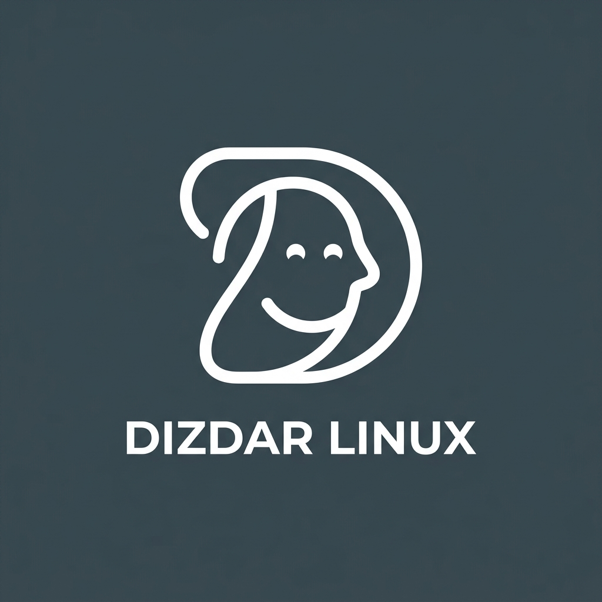

# 🚀 Dizdar Linux

<p align="center">
  
</p>

<p align="center">
  <b>Hafif, Güçlü, Modern ve Kullanıcı Dostu Açık Kaynak Türkçe İşletim Sistemi</b><br>
  <i>Windows 11 Görünümü &bull; Debian Kararlılığı &bull; Sadece ~500 MB RAM Tüketimi</i>
</p>

<p align="center">
  
  
  
  
</p>

---

## 🌟 Dizdar Linux Nedir?

**Dizdar Linux**, modern bilgisayar kullanıcılarının ve eski donanımlara sahip bireylerin ihtiyaç duyduğu hız, kararlılık ve estetiği bir araya getiren bağımsız bir GNU/Linux dağıtımıdır.

Dünyanın en güvenilir ve sağlam işletim sistemi tabanı olan **Debian 12 (Bookworm)** üzerine inşa edilmiştir. Kullanıcıların alışık olduğu Windows 11 tasarım dilini, Linux dünyasının en tüy sıklet masaüstü ortamı olan **XFCE** ile birleştirerek hem göz alıcı bir estetik hem de sıradışı bir performans sunar.

---

## ✨ Temel Özellikler

- 🪟 **Windows 11 Tasarım Dili:** Alt kısma konumlandırılmış görev çubuğu, ortalanmış modern Whisker başlat menüsü ve tanıdık pencere düzeni.
- ⚡ **Tüy Siklet Performans:** Sistem boştayken yalnızca **~450-550 MB RAM** tüketir. Windows 11'in açılmakta zorlandığı 10-15 yıllık bilgisayarlara dahi ikinci bir hayat verir.
- 🎮 **Windows Uygulama (.exe / .msi) Desteği:** Entegre **Wine** altyapısı sayesinde sevdiğiniz Windows programlarını ve oyunlarını ek bir kuruluma gerek kalmadan doğrudan çift tıklayarak çalıştırın.
- 📱 **Android (.apk) Entegrasyonu:** Entegre **Waydroid** desteğiyle mobil Android uygulamalarını masaüstünüzde tam hızda kullanın.
- 🛠️ **Geniş Donanım Desteği:** `non-free` ve `non-free-firmware` sürücüleri (Intel, AMD, Nvidia ekran kartları, Realtek, Broadcom Wi-Fi yongaları) ISO içerisine gömülüdür; kurulumda sürücü arama derdi yaşanmaz.
- 🖱️ **Pürüzsüz Kurulum:** Kullanıcı dostu ve Türkçe **Calamares** grafiksel yükleyicisi sayesinde birkaç tıkla ister tek başına, ister mevcut Windows'un yanına (Dual-Boot) kurulabilir.

---

## 🖥️ Sistem Gereksinimleri

| Donanım | Minimum (Eski PC'ler İçin) | Önerilen |
| :--- | :--- | :--- |
| **İşlemci (CPU)** | 64-bit Çift Çekirdekli (Intel Core 2 Duo / AMD Athlon 64) | 64-bit Dört Çekirdekli İşlemci |
| **Bellek (RAM)** | 2 GB RAM | 4 GB veya daha fazlası |
| **Depolama** | 15 GB Boş Alan (HDD veya SSD) | 30 GB SSD |
| **Ekran** | 1024x768 Çözünürlük | 1920x1080 (Full HD) veya üzeri |

---

## 📥 İndirme ve Kurulum

### 1. ISO Dosyasını İndirin
En güncel kararlı sürüm ISO kalıbını projenin [Releases (Sürümler)](https://github.com/edizdar/dizdar-linux-builder/releases) sayfasından veya GitHub Actions Artifacts üzerinden edinebilirsiniz.

### 2. USB Belleğe Yazdırın
İndirdiğiniz `.iso` dosyasını en az 4 GB kapasiteli bir USB belleğe yazdırmak için şu araçları kullanabilirsiniz:
* **[Rufus](https://rufus.ie/)** (Windows kullanıcıları için önerilir)
* **[Ventoy](https://www.ventoy.net/)** (Çoklu işletim sistemi USB'si için)
* **[balenaEtcher](https://www.balena.io/etcher/)** (Çoklu platform)

### 3. Bilgisayarı USB'den Başlatın (Boot)
Bilgisayarınızı yeniden başlatın ve açılışta Boot tuşuna (**F12**, **F11**, **F8** veya **Esc**) basarak USB belleğinizi seçin.

### 4. Deneyin veya Kalıcı Olarak Kurun
Sistem doğrudan **Canlı (Live)** modda açılır; diskinize hiçbir zarar vermeden sistemi deneyebilir, ardından masaüstündeki **"Dizdar Linux'u Kur"** simgesine tıklayarak kalıcı kuruluma geçebilirsiniz.

---

## 🛠️ Kaynak Koddan Kendiniz Derleyin

Dizdar Linux'u kendi yerel ortamınızda veya Debian/Ubuntu üzerinde derlemek için:

```bash
# Depoyu klonlayın
git clone https://github.com/edizdar/dizdar-linux-builder.git
cd dizdar-linux-builder

# Derleme betiğine çalıştırma yetkisi verin
chmod +x build.sh

# Root yetkisiyle derlemeyi başlatın
sudo ./build.sh
```

Derleme tamamlandığında klasörde `binary.iso` dosyanız oluşacaktır.

---

## 🤝 Katkıda Bulunma

Dizdar Linux tamamen topluluk odaklı ve açık kaynaklı bir projedir! Her türlü katkıya açığız:
* 🐛 Hata bildirmek veya yeni özellik önermek için [Issues](https://github.com/edizdar/dizdar-linux-builder/issues) sekmesini kullanın.
* 🎨 Yeni temalar, simgeler veya duvar kağıtları tasarlıyorsanız Pull Request (PR) açmaktan çekinmeyin.
* Ayrıntılı yönergeler için lütfen [CONTRIBUTING.md](CONTRIBUTING.md) belgesini inceleyin.

---

## 📜 Lisans

Bu proje **[GNU General Public License v3.0 (GPL-3.0)](LICENSE)** ile lisanslanmıştır.  
Özgür Yazılım Vakfı (FSF) ilkeleri doğrultusunda herkes bu projeyi inceleyebilir, geliştirebilir ve özgürce paylaşabilir.
